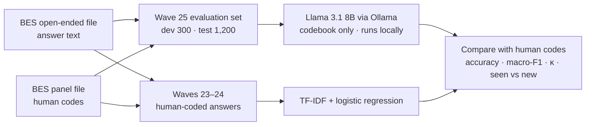

# Can a small local LLM code survey answers like trained human coders?

**A privacy-first evaluation on the British Election Study's "most important issue" question**

`Python` · `pandas` · `scikit-learn` · `Ollama` · `Llama 3.1 8B` · `structured outputs`

> **Status:** in progress. Development-set results are in. The final run on the untouched test set (1,200 answers) is next.

## At a glance

**The question.** Survey teams pay people to read and code thousands of open-ended answers. Can a small open-weight model, running entirely on a laptop, code them as well as trained human coders, using no training data and only a written codebook?

**The answer so far** (development set: 300 answers from May 2023):

- With only a codebook, Llama 3.1 8B **matched a classifier trained on {{N_TRAIN}} human-coded answers**: 96.7% accuracy on 12 categories and 96.3% on 50 (Cohen's κ 0.95–0.96).
- It did **better on small categories** (macro-F1 78.6% vs 70.9% on 12 categories; 80.4% vs 76.7% on 50) and **on answers worded in new ways** (86.8% vs 78.9%; 84.2% vs 81.6%).
- All coding ran locally, with no API costs and about 7 seconds per answer on a 16 GB laptop. No survey answers went to cloud AI services for coding.
- Caveats: the development set is small, and the codebook was tuned on it. The test set will give the honest number.

## Why this matters

- Open-ended questions are some of the most informative in a survey, and some of the most expensive to analyse, because every answer must be read and assigned to a category.
- Cloud LLMs can do this, but sending respondents' free text to a third party raises data-protection and licence questions. Many data licences, the BES's included, restrict sharing data with third parties.
- A local model avoids both problems, provided it is accurate enough. This project measures that carefully.

## The data

- **Source:** the British Election Study (BES) Internet Panel's open-ended "most important issue" (MII) question: *"As far as you're concerned, what is the SINGLE MOST important issue facing the country at the present time?"*
- **Human codes:** BES research associates coded every answer into **50 categories** (`mii_cat`), which the BES collapses into **12** (`small_mii_cat`). Answers too vague to code get "Uncoded". I keep that as a 13th class in the 12-category scheme.
- **Why wave 25 (May 2023):** according to the BES codebook, answers from **wave 26 onwards were coded by GPT-4o**, not by people. Testing against those codes would grade AI against AI, so I use wave 25, the most recent wave with human codes.
- **Imbalance:** in wave 25, **59%** of coded answers were about the economy, and 34% were "cost of living" alone. A model that always answers "Economy" scores 59% accuracy without reading anything, so I report macro-F1 and Cohen's κ next to accuracy.
- The data is free to download after registering with the BES, under its terms of use. **It is not included in this repository.**

## Method



1. **Evaluation set.** From all wave 25 answers that have text and a human code, I drew a stratified random sample (seed 2026): **300 dev answers** for building and tuning, and **1,200 test answers** kept untouched until the final run.
2. **Baselines.**
   - *Always guess the most common category.* This shows how little accuracy means on imbalanced data.
   - *TF-IDF + logistic regression.* It is trained on {{N_TRAIN}} human-coded answers from **waves 23–24**. Every evaluation respondent is left out, so the model never sees their earlier answers. It uses character n-grams (2–5 letters), so typos still match, with default settings.
3. **LLM coder.** Llama 3.1 8B Instruct (`llama3.1:latest`, 4.9 GB) runs through Ollama 0.35 with nothing but the codebook:
   - **Answers are restricted to codebook names** through Ollama's structured outputs (a JSON schema with an `enum`), so every reply is a valid category. There were 0 invalid replies in 600 calls.
   - **The codebook sits in the system message, and each scheme runs separately.** Ollama reuses the already-processed codebook, so after a slow first call each answer takes about 6–8 seconds.
   - **Runs are reproducible:** temperature 0, a fixed seed, and a prompt-version hash stored with every output row. The codebooks were frozen after the dev run.
   - **Results are saved after every answer**, so a long run can stop and resume safely.
4. **Codebooks.** I wrote them from the BES coding guide, checked them against the category labels in the data, reviewed them against the 300 dev answers (see `docs/codebook_review.md`), and then froze them.
5. **Metrics.**
   - Accuracy.
   - Macro-F1: every category counts equally.
   - Cohen's κ: agreement beyond chance.
   - Accuracy split by whether an answer's exact text already appears in the training waves (**seen**) or not (**new**).

## Results so far: development set (300 answers)

| Scheme | Method | Training data | Accuracy | Macro-F1 | Cohen's κ | Accuracy on new answers* |
|---|---|---|---|---|---|---|
| 12 categories | Always "Economy" | – | 59.0% | 6.2% | 0.00 | – |
| | TF-IDF + logistic regression | {{N_TRAIN}} coded answers | 96.7% | 70.9% | 0.95 | 78.9% |
| | **Llama 3.1 8B, codebook only** | **none** | **96.7%** | **78.6%** | **0.95** | **86.8%** |
| 50 categories | Always "Living costs" | – | 33.7% | 1.7% | 0.00 | – |
| | TF-IDF + logistic regression | {{N_TRAIN}} coded answers | 96.3% | 76.7% | 0.96 | 81.6% |
| | **Llama 3.1 8B, codebook only** | **none** | **96.3%** | **80.4%** | **0.96** | **84.2%** |

\* 38 of the 300 dev answers use wording that does not appear in waves 23–24.

**What the dev results show**

1. **Most answers repeat earlier phrases.** 87% of dev answers (262 of 300) appear word for word in the training waves. The classifier is almost perfect on those (98–99%). On new wording it drops to about 80%, close to the 77.8% that Mellon et al. (2024) report for a supervised model on new text.
2. **A codebook can stand in for tens of thousands of labels.** With no training data, Llama matched the classifier's overall accuracy and did better on small categories and on new wording.
3. **Both methods are close to the ceiling.** In Mellon et al. (2024), a second human coder agreed with the BES coders on 94.7% of a random sample. Some of the remaining "errors" are debatable human codes. For example, a one-word answer about corruption was coded Morals, although the BES guide places corruption under Pol-neg.
4. **Asking the model "are you sure?" doesn't work.** Llama flagged 0 of its 600 codes as uncertain, including the ones it got wrong.

**Caveats.** On new answers, Llama's lead amounts to 3 answers (12 categories) and 1 answer (50 categories). The codebook was also reviewed against these same dev answers, which flatters Llama. The test set is the honest measurement.

## Final results: test set (1,200 answers)

*Pending. The codebooks and prompt are frozen (prompt versions `459a2e64` and `b0fcfe68`), and the same scripts will run once on the untouched test set.*

| Scheme | Method | Accuracy | Macro-F1 | Cohen's κ | Accuracy on new answers |
|---|---|---|---|---|---|
| 12 categories | TF-IDF + logistic regression | – | – | – | – |
| | Llama 3.1 8B, codebook only | – | – | – | – |
| 50 categories | TF-IDF + logistic regression | – | – | – | – |
| | Llama 3.1 8B, codebook only | – | – | – | – |

## Privacy and data handling

- **Local inference only:** every coding run uses Ollama on my own machine. No survey answers are sent to cloud AI APIs for coding.
- **Nothing sensitive is committed:** raw BES files, answer text and respondent IDs stay in `data/`, which git ignores. The repository holds only code, codebooks and aggregate results, and the scripts print counts and metrics, never answers.
- **Data minimisation:** each script reads only the columns it needs, for example 3 of the panel file's 13,381.
- **Licence:** the BES terms allow research use and require attribution. I have contacted the BES team to confirm that a public portfolio project fits those terms.
- **Transparency:** the decision log records one process deviation during development (D-009), when a small set of short dev answers was shared with an AI assistant.

## Repository structure

```
ai-survey-coding-eval/
├── codebooks/
│   ├── codebook_12.json        # 12 categories + Uncoded: name, definition, examples
│   └── codebook_50.json        # 49 BES categories
├── data/                       # git-ignored: BES files and all answer-level outputs
├── docs/
│   ├── decision_log.md         # every design decision and why
│   └── codebook_review.md      # how the codebooks were checked against dev answers
├── results/                    # aggregate numbers only
│   ├── baseline_dev.json
│   └── llm_dev.json
├── scripts/
│   ├── time_ollama.py          # speed test on invented answers
│   ├── inspect_bes.py          # find the wave 25 columns (names only)
│   ├── build_eval_set.py       # join answers to human codes; stratified dev/test split
│   ├── check_mapping.py        # verify how the 50 categories collapse into 12
│   ├── prepare_codebooks.py    # codebook skeletons + local example sheet
│   ├── check_codebooks.py      # names match the data; no copied answers
│   ├── baseline.py             # majority + TF-IDF baselines, seen vs new split
│   ├── llm_code.py             # Llama codes the answers (local, resumable)
│   └── score_llm.py            # compare Llama with the human codes and baselines
├── requirements.txt
└── README.md
```

## How to reproduce

1. **Get the data.** Register for free at [britishelectionstudy.com](https://www.britishelectionstudy.com), go to *Data → Panel study data*, and download the SPSS versions of:
   - *Combined Wave 1–30 Internet Panel open ended response data*
   - *Combined Wave 1–31 Internet Panel*

   Unzip both into `data/raw/`. The scripts expect `BES2024_W30Strings_v30.1.sav` and `BES2024_W31_Panel_v31.05.sav`. If your versions differ, edit the paths at the top of each script.
2. **Set up Python.**
   ```bash
   python -m venv .venv
   .venv\Scripts\activate          # macOS/Linux: source .venv/bin/activate
   pip install -r requirements.txt
   ```
3. **Install [Ollama](https://ollama.com) and the model:** `ollama pull llama3.1`
4. **Run the pipeline.**
   ```bash
   python scripts/inspect_bes.py
   python scripts/build_eval_set.py
   python scripts/check_mapping.py
   python scripts/check_codebooks.py
   python scripts/baseline.py
   python scripts/llm_code.py        # about 70 minutes for the dev set on a 16 GB laptop
   python scripts/score_llm.py
   ```

## Lessons learned

- **Check who made your labels.** Recent BES codes were produced by GPT-4o, so using them as ground truth would have been circular.
- **Accuracy hides imbalance.** "Always Economy" scores 59%. Macro-F1 and κ show it up.
- **Separate seen answers from new ones.** A 96% classifier was mostly recognising repeated phrases. On new wording it scored about 80%.
- **Trust the data over the documentation.** The codebook's 50→12 table leaves out three categories, and three label spellings differ from the data. I verified everything against the data itself (D-008).
- **A model's self-reported confidence is not a confidence score.** Testing better uncertainty signals is the next step.
- **Engineering details decide feasibility.** Reusing the cached codebook cut each local call from minutes to seconds.

## Next steps

- **Second-opinion routing:** when Llama and the classifier disagree, send the answer to a human. How much checking would that take, and how many errors would remain?
- **Final test-set run:** about 5 hours overnight, then fill in the table above.
- **Blind review of disagreements:** wherever Llama and the BES coder differ, judge which code is right without knowing which is which.
- **Robustness:** try a second local model and prompt variants, because a single configuration can mislead (Baumann et al., 2025).

## Key decisions

Every decision is recorded in [`docs/decision_log.md`](docs/decision_log.md). The most important ones:

- **D-001:** local inference only.
- **D-002:** evaluate on wave 25.
- **D-005:** keep "Uncoded" as its own class.
- **D-010:** the two baselines.
- **D-011:** the seen vs new split.
- **D-013:** codebooks frozen before the test run.

## How this was built

I built this project with an AI assistant as mentor and pair programmer. I ran every step on my own machine and reviewed the code and the codebooks. The reasoning behind each choice is in the decision log.

## References

- Fieldhouse, E., Green, J., Evans, G., Mellon, J., Prosser, C., Bailey, J., de Geus, R., Schmitt, H., van der Eijk, C., Griffiths, J., & Perrett, S. (2026). *British Election Study Internet Panel Waves 1–31*. DOI: [10.5255/UKDA-SN-8202-4](https://doi.org/10.5255/UKDA-SN-8202-4)
- Mellon, J., Bailey, J., Scott, R., Breckwoldt, J., Miori, M., & Schmedeman, P. (2024). Do AIs know what the most important issue is? Using language models to code open-text social survey responses at scale. *Research & Politics*, 11(1). [Open access](https://orca.cardiff.ac.uk/id/eprint/177688/)
- Baumann, J., Röttger, P., Urman, A., Wendsjö, A., Plaza-del-Arco, F. M., Gruber, J. B., & Hovy, D. (2025). *Large Language Model Hacking: Quantifying the Hidden Risks of Using LLMs for Text Annotation*. [arXiv:2509.08825](https://arxiv.org/abs/2509.08825)

## Disclaimer and licence

This is an independent project, not affiliated with or endorsed by the British Election Study or its funders. BES data is not included in this repository and remains subject to the [BES terms of data use](https://www.britishelectionstudy.com/terms-and-conditions-of-data-use/). The code is released under the MIT licence.

## Author

**Adeel Manaf**, data scientist (Python, R, statistics) building applied-AI tools for survey research.
[LinkedIn]({{LINKEDIN_URL}}) · [GitHub]({{GITHUB_URL}}) · [Email](mailto:{{EMAIL}})
