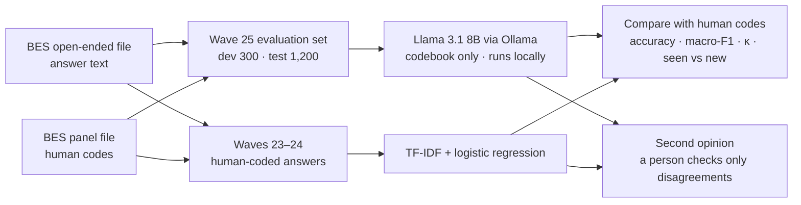

# Can a small local LLM code survey answers like trained human coders?

**A privacy-first evaluation on the British Election Study's "most important issue" question**

`Python` · `pandas` · `scikit-learn` · `Ollama` · `Llama 3.1 8B` · `structured outputs`

> **Status:** complete. The final results come from a single run on 1,200 test answers that stayed untouched until the codebooks and prompt were frozen.

## At a glance

**The question.** Survey teams pay people to read and code thousands of open-ended answers. Can a small open-weight model, running entirely on a laptop, code them as well as trained human coders, using no training data and only a written codebook?

**The answer** (test set: 1,200 answers from May 2023):

- **Close, with no training data at all.** Given only a codebook, Llama 3.1 8B gave the same code as the BES's human coders for 95.4% of answers on 12 categories and 95.9% on 50 (Cohen's κ 0.93–0.95).
- **A simple classifier trained on 42,404 past human codes did as well or better:** 97.4% and 96.0%. Its lead comes from answers it had effectively seen before: 89% of test answers repeat earlier wording word for word. On new wording, the two were level on 12 categories, and Llama was ahead on 50, though with only 131 new answers that gap could be chance.
- **Together, with a quick human check, they beat either one.** The two methods agree on 95% of answers, and those agreed codes are 98.7–99.2% correct. If a person checks only the other 5%, accuracy rises to about 99% (best case).
- **The development set flattered Llama.** On the 300 dev answers I used to refine the codebook, Llama tied the classifier. The untouched test set gave the honest answer.
- **It all ran locally** on a 16 GB laptop: about 6–8 seconds per answer, no API costs, and 0 invalid replies in 3,000 calls. No survey answers went to cloud AI services for coding.

## What I'd tell a survey team

- **You have thousands of past human codes for the same question?** Train a simple classifier. It is fast, cheap and hard to beat on answers that repeat.
- **A new question, or no past codes?** A local LLM with a careful codebook got about 95% here with no training data, and the answers never leave your machine.
- **You need near-human quality at low cost?** Run both, and have a person check only the ~5% of answers where they disagree.

## Why this matters

- Open-ended questions are some of the most informative in a survey, and some of the most expensive to analyse, because every answer must be read and assigned to a category.
- Cloud LLMs can do this, but sending respondents' free text to a third party raises data-protection and licence questions. Many data licences, the BES's included, restrict sharing data with third parties.
- A local model avoids both problems, provided it is accurate enough. This project measures that carefully.

## The data

- **Source:** the British Election Study (BES) Internet Panel's open-ended "most important issue" (MII) question: _"As far as you're concerned, what is the SINGLE MOST important issue facing the country at the present time?"_
- **Human codes:** BES research associates coded every answer into **50 categories** (`mii_cat`), which the BES collapses into **12** (`small_mii_cat`). Answers too vague to code get "Uncoded". I keep that as a 13th class in the 12-category scheme.
- **Why wave 25 (May 2023):** according to the BES codebook, answers from **wave 26 onwards were coded by GPT-4o**, not by people. Testing against those codes would grade AI against AI, so I use wave 25, the most recent wave with human codes.
- **Imbalance:** in wave 25, **59%** of coded answers were about the economy, and 34% were "cost of living" alone. A model that always answers "Economy" scores 59% accuracy without reading anything, so I report macro-F1 and Cohen's κ next to accuracy.
- The data is free to download after registering with the BES, under its terms of use. **It is not included in this repository.**

## Method



1. **Evaluation set.** From all wave 25 answers that have text and a human code, I drew a stratified random sample (seed 2026): **300 dev answers** for building and tuning, and **1,200 test answers** kept untouched until the final run.
2. **Baselines.**
   - _Always guess the most common category._ This shows how little accuracy means on imbalanced data.
   - _TF-IDF + logistic regression._ It is trained on 42,404 human-coded answers from **waves 23–24**. Every evaluation respondent is left out, so the model never sees their earlier answers. It uses character n-grams (2–5 letters), so typos still match, with default settings.
3. **LLM coder.** Llama 3.1 8B Instruct (`llama3.1:latest`, 4.9 GB) runs through Ollama with nothing but the codebook:
   - **Answers are restricted to codebook names** through Ollama's structured outputs (a JSON schema with an `enum`), so every reply is a valid category. There were 0 invalid replies in 3,000 calls.
   - **The codebook sits in the system message, and each scheme runs separately.** Ollama reuses the already-processed codebook, so after a slow first call each answer takes about 6–8 seconds.
   - **Runs are reproducible:** temperature 0, a fixed seed, and a prompt-version hash stored with every output row.
   - **Results are saved after every answer, and failed calls are retried,** so a 5-hour run can stop and resume safely.
   - **Software versions:** the dev run used Ollama 0.35.0. Before the test run, Ollama updated itself to 0.35.1, which put part of the model on the laptop's old graphics chip and crashed. The test run therefore used the CPU only (`num_gpu: 0`). Re-coding 10 dev answers with the new setup gave exactly the same codes as the original dev run (D-017).
4. **Codebooks.** I wrote them from the BES coding guide, checked them against the category labels in the data, reviewed them against the 300 dev answers (see `docs/codebook_review.md`), and froze them before the test run (prompt versions `459a2e64` and `b0fcfe68`).
5. **Second opinion.** Where Llama and the classifier give different codes, a person would check the answer. I measure how many answers that is, and how accurate the final codes would be.
6. **Metrics.**
   - Accuracy.
   - Macro-F1: every category counts equally.
   - Cohen's κ: agreement beyond chance.
   - Accuracy split by whether an answer's exact text already appears in the training waves (**seen**) or not (**new**).
   - McNemar's exact test, to check whether a difference between the two methods could be chance.

## Final results: test set (1,200 answers, run once)

| Scheme        | Method                       | Training data        | Accuracy | Macro-F1 | Cohen's κ | Accuracy on new answers\* |
| ------------- | ---------------------------- | -------------------- | -------- | -------- | --------- | ------------------------- |
| 12 categories | Always "Economy"             | –                    | 59.0%    | 5.7%     | 0.00      | –                         |
|               | TF-IDF + logistic regression | 42,404 coded answers | 97.4%    | 80.1%    | 0.96      | 80.9%                     |
|               | Llama 3.1 8B, codebook only  | none                 | 95.4%    | 78.3%    | 0.93      | 80.2%                     |
| 50 categories | Always "Living costs"        | –                    | 33.8%    | 1.3%     | 0.00      | –                         |
|               | TF-IDF + logistic regression | 42,404 coded answers | 96.0%    | 74.1%    | 0.95      | 77.1%                     |
|               | Llama 3.1 8B, codebook only  | none                 | 95.9%    | 73.8%    | 0.95      | 83.2%                     |

\* 131 of the 1,200 test answers (11%) use wording that does not appear in waves 23–24. Each overall accuracy is uncertain by about ±1 percentage point (95% interval). With only 131 new answers, the new-answer figures are uncertain by about ±7 points.

**What the test results show**

1. **On 12 categories the classifier is better, and not by chance.** Of the 58 answers where exactly one method was right, the classifier was right on 41 and Llama on 17 (McNemar's exact test, p = 0.002). On 50 categories it's a tie: 27 against 26 (p = 1.0).
2. **The classifier's lead comes from answers it has seen before.** 1,069 of the 1,200 answers (89%) appear word for word in waves 23–24, and on those the classifier was 99.4% accurate on 12 categories. On the 131 new answers, the two methods were level (80.9% and 80.2%). On 50 categories, Llama was ahead on new answers (83.2% against 77.1%), but that gap is within the uncertainty. The classifier's 77–81% on new wording is in line with the 77.8% that Mellon et al. (2024) report for a supervised model on new text.
3. **The dev set flattered Llama.** On dev, Llama tied the classifier on accuracy and led on macro-F1. On test, that lead disappeared. I had refined the codebook while reading dev mistakes, and 300 answers is a noisy sample. That's exactly why the test set stayed untouched until one final run.
4. **Llama is more accurate with 50 categories than with 12** (95.9% against 95.4%), even though 50 categories is the harder task. Many of its 12-category mistakes put answers into the broad "Austerity/spending" and "Inequality" groups (at least 13 and 10 of its 55 mistakes). Each of the 50 categories belongs to exactly one of the 12 groups, so grouping Llama's 50-category codes would score at least 95.9% on the 12-category scheme. That's worth testing on fresh data.
5. **Asking the model "are you sure?" still doesn't work.** Llama marked only 2 of its 2,400 test codes as uncertain (both were right), and none of its 600 dev codes. Disagreement with a second method is a much better warning sign (next section).
6. **Both methods are close to the ceiling.** In Mellon et al. (2024), a second human coder agreed with the BES coders on 94.7% of a random sample, so some of the remaining "errors" are likely debatable human codes.

## Second opinion: use both, check only where they disagree

| Test set (1,200 answers)                             | 12 categories     | 50 categories     |
| ---------------------------------------------------- | ----------------- | ----------------- |
| Llama and the classifier give the same code          | 1,137 (95%)       | 1,140 (95%)       |
| ...and that code matches the BES coder               | 99.2%             | 98.7%             |
| Disagreements a person would check                   | 63 (5%)           | 60 (5%)           |
| ...right code from: classifier / Llama / neither     | 41 / 17 / 5       | 27 / 26 / 7       |
| Llama's mistakes that land among the checked answers | 46 of 55          | 34 of 49          |
| **Accuracy: Llama alone → with the check**           | **95.4% → 99.2%** | **95.9% → 98.8%** |

- This assumes the person checking always gives the BES coder's code, which is the best case.
- The mistakes both methods share (9 and 15 answers) never reach a person. Some of them may be debatable human codes.
- On the dev set, the same check gave 99.3% for both schemes, so the result held up on new data.

## Development set (300 answers)

| Scheme        | Method                       | Training data        | Accuracy | Macro-F1 | Cohen's κ | Accuracy on new answers\* |
| ------------- | ---------------------------- | -------------------- | -------- | -------- | --------- | ------------------------- |
| 12 categories | Always "Economy"             | –                    | 59.0%    | 6.2%     | 0.00      | –                         |
|               | TF-IDF + logistic regression | 42,404 coded answers | 96.7%    | 70.9%    | 0.95      | 78.9%                     |
|               | Llama 3.1 8B, codebook only  | none                 | 96.7%    | 78.6%    | 0.95      | 86.8%                     |
| 50 categories | Always "Living costs"        | –                    | 33.7%    | 1.7%     | 0.00      | –                         |
|               | TF-IDF + logistic regression | 42,404 coded answers | 96.3%    | 76.7%    | 0.96      | 81.6%                     |
|               | Llama 3.1 8B, codebook only  | none                 | 96.3%    | 80.4%    | 0.96      | 84.2%                     |

\* 38 of the 300 dev answers use wording that does not appear in waves 23–24.

On dev, Llama matched the classifier's accuracy and led on macro-F1 and on new answers. The test set narrowed or reversed those leads (see finding 3 above). With only 38 new dev answers, Llama's lead there amounted to 3 answers (12 categories) and 1 answer (50 categories).

## Privacy and data handling

- **Local inference only:** every coding run uses Ollama on my own machine. No survey answers are sent to cloud AI APIs for coding.
- **Nothing sensitive is committed:** raw BES files, answer text and respondent IDs stay in `data/`, which git ignores. The repository holds only code, codebooks and aggregate results, and the scripts print counts and metrics, never answers.
- **Data minimisation:** each script reads only the columns it needs, for example 3 of the panel file's 13,381.
- **Licence:** the BES terms allow research use and require attribution. I have contacted the BES team to confirm that a public portfolio project fits those terms.
- **Transparency:** the decision log records one process deviation during development (D-009), when a small set of short dev answers was shared with an AI assistant.

## Repository structure

```
ai-survey-coding-eval/
├── codebooks/
│   ├── codebook_12.json        # 12 categories + Uncoded: name, definition, examples
│   └── codebook_50.json        # 49 BES categories
├── data/                       # git-ignored: BES files and all answer-level outputs
├── docs/
│   ├── decision_log.md         # every design decision and why
│   └── codebook_review.md      # how the codebooks were checked against dev answers
├── results/                    # aggregate numbers only
│   ├── baseline_dev.json
│   ├── baseline_test.json
│   ├── llm_dev.json
│   ├── llm_test.json
│   ├── second_opinion_dev.json
│   └── second_opinion_test.json
├── scripts/
│   ├── time_ollama.py          # speed test on invented answers
│   ├── inspect_bes.py          # find the wave 25 columns (names only)
│   ├── build_eval_set.py       # join answers to human codes; stratified dev/test split
│   ├── check_mapping.py        # verify how the 50 categories collapse into 12
│   ├── prepare_codebooks.py    # codebook skeletons + local example sheet
│   ├── check_codebooks.py      # names match the data; no copied answers
│   ├── baseline.py             # majority + TF-IDF baselines, seen vs new split
│   ├── llm_code.py             # Llama codes the answers (local, resumable, retries)
│   ├── score_llm.py            # compare Llama with the human codes and baselines
│   ├── second_opinion.py       # what if a person checks only the disagreements?
│   └── diagnose_ollama.py      # find why Ollama crashes, one setting at a time
├── requirements.txt
└── README.md
```

## How to reproduce

1. **Get the data.** Register for free at [britishelectionstudy.com](https://www.britishelectionstudy.com), go to _Data → Panel study data_, and download the SPSS versions of:
   - _Combined Wave 1–30 Internet Panel open ended response data_
   - _Combined Wave 1–31 Internet Panel_

   Unzip both into `data/raw/`. The scripts expect `BES2024_W30Strings_v30.1.sav` and `BES2024_W31_Panel_v31.05.sav`. If your versions differ, edit the paths at the top of each script.

2. **Set up Python.**
   ```bash
   python -m venv .venv
   .venv\Scripts\activate          # macOS/Linux: source .venv/bin/activate
   pip install -r requirements.txt
   ```
3. **Install [Ollama](https://ollama.com) and the model:** `ollama pull llama3.1`
4. **Run the pipeline on the dev set.**
   ```bash
   python scripts/inspect_bes.py
   python scripts/build_eval_set.py
   python scripts/check_mapping.py
   python scripts/check_codebooks.py
   python scripts/baseline.py
   python scripts/llm_code.py        # about 70 minutes for 300 dev answers on a 16 GB laptop
   python scripts/score_llm.py
   python scripts/second_opinion.py
   ```
5. **Final run on the test set.** Set `SPLIT = "test"` at the top of `baseline.py`, `llm_code.py`, `score_llm.py` and `second_opinion.py`, then run those four again. Coding 1,200 answers in both schemes takes about 5 hours.
6. **If Ollama crashes,** run `python scripts/diagnose_ollama.py`. It tries one setting at a time and suggests a fix.

## Lessons learned

- **Keep a test set you only touch once.** On the dev set, Llama tied the classifier. On the untouched test set, the classifier was ahead on 12 categories. I had refined the codebook while reading dev mistakes, and that flattered Llama.
- **Check who made your labels.** Recent BES codes were produced by GPT-4o, so using them as ground truth would have been circular.
- **Accuracy hides imbalance.** "Always Economy" scores 59%. Macro-F1 and κ show it up.
- **Separate seen answers from new ones.** 89% of test answers repeat earlier wording. The classifier was 98–99% accurate on those, but 77–81% on new wording.
- **Disagreement is a better warning sign than self-reported confidence.** Llama almost never said it was unsure. But the 5% of answers where it and the classifier disagreed held 69–84% of its mistakes.
- **Trust the data over the documentation.** The codebook's 50→12 table leaves out three categories, and three label spellings differ from the data. I verified everything against the data itself (D-008).
- **Silent updates can break a long run.** Ollama updated itself between my dev and test runs, and the new version crashed on the laptop's old graphics chip. A script that changed one setting at a time found the cause. I switched to the CPU only, and checked on 10 dev answers that the codes didn't change (D-017).
- **Engineering details decide feasibility.** Reusing the cached codebook cut each local call from minutes to seconds.

## Next steps

- **Code fine, then group:** derive the 12 categories from Llama's 50-category codes, and test it on another human-coded wave, since this test set has now been used.
- **Blind review:** for the disagreements and the shared mistakes, judge which code is right without knowing where it came from. Some "errors" are probably debatable human codes.
- **A realistic second opinion:** measure how often a real reviewer matches the BES coder. The 99% assumes they always do.
- **Robustness:** try a second local model and prompt variants, because a single configuration can mislead (Baumann et al., 2025).

## Key decisions

Every decision is recorded in [`docs/decision_log.md`](docs/decision_log.md). The most important ones:

- **D-001:** local inference only.
- **D-002:** evaluate on wave 25.
- **D-005:** keep "Uncoded" as its own class.
- **D-010:** the two baselines.
- **D-011:** the seen vs new split.
- **D-013:** codebooks frozen before the test run.
- **D-014:** the second-opinion check.
- **D-017:** the test run used the CPU only, after an Ollama update crashed on the graphics chip.

## How this was built

I built this project with an AI assistant as mentor and pair programmer. I ran every step on my own machine and reviewed the code and the codebooks. The reasoning behind each choice is in the decision log.

## References

- Fieldhouse, E., Green, J., Evans, G., Mellon, J., Prosser, C., Bailey, J., de Geus, R., Schmitt, H., van der Eijk, C., Griffiths, J., & Perrett, S. (2026). _British Election Study Internet Panel Waves 1–31_. DOI: [10.5255/UKDA-SN-8202-4](https://doi.org/10.5255/UKDA-SN-8202-4)
- Mellon, J., Bailey, J., Scott, R., Breckwoldt, J., Miori, M., & Schmedeman, P. (2024). Do AIs know what the most important issue is? Using language models to code open-text social survey responses at scale. _Research & Politics_, 11(1). [Open access](https://orca.cardiff.ac.uk/id/eprint/177688/)
- Baumann, J., Röttger, P., Urman, A., Wendsjö, A., Plaza-del-Arco, F. M., Gruber, J. B., & Hovy, D. (2025). _Large Language Model Hacking: Quantifying the Hidden Risks of Using LLMs for Text Annotation_. [arXiv:2509.08825](https://arxiv.org/abs/2509.08825)

## Disclaimer and licence

This is an independent project, not affiliated with or endorsed by the British Election Study or its funders. BES data is not included in this repository and remains subject to the [BES terms of data use](https://www.britishelectionstudy.com/terms-and-conditions-of-data-use/). The code is released under the MIT licence.

## Author

**Adeel Manaf**, data scientist (Python, R, statistics) building applied-AI tools for survey research.
[LinkedIn]({{https://www.linkedin.com/in/adeel-manaf/}}) · [GitHub]({{https://github.com/adeelmanaf43}}) · [Email](mailto:{{adeelmanaf00@gmail.com}})
