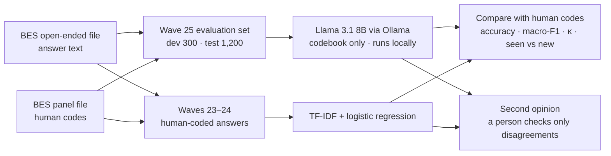
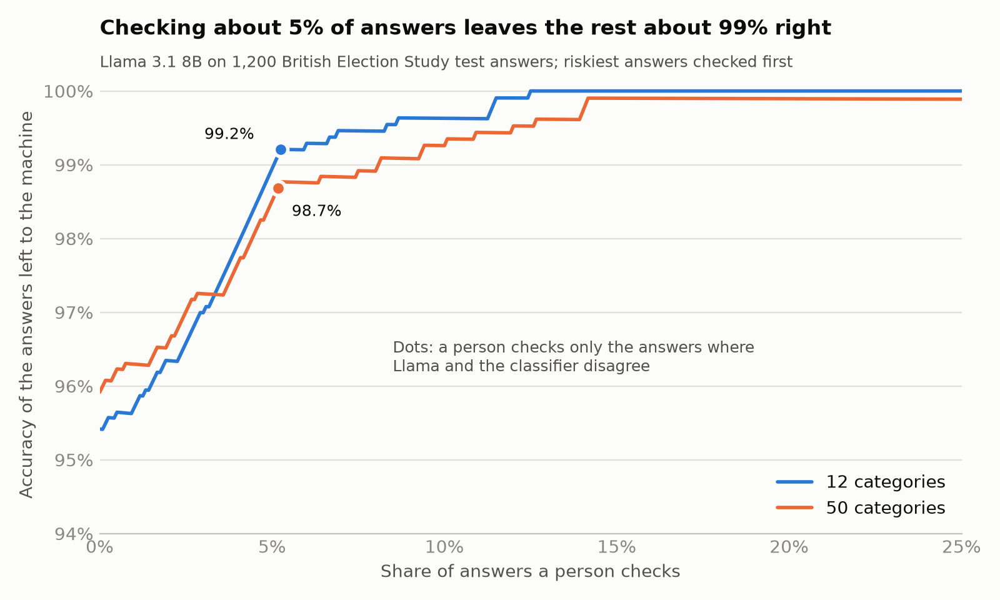

# Can a small local LLM code survey answers like trained human coders?

**A privacy-first evaluation on the British Election Study's "most important issue" question**

`Python` · `pandas` · `scikit-learn` · `Ollama` · `Llama 3.1 8B` · `structured outputs`

> **Status:** complete. The final results come from a single run on 1,200 test answers that stayed untouched until the codebooks and prompt were frozen.

## At a glance

**The question.** Survey teams pay people to read and code thousands of open-ended answers. Can a small open-weight model, running entirely on a laptop, code them as well as trained human coders, using no training data and only a written codebook?

**The answer** (test set: 1,200 answers from May 2023):

- **Close, with no training data at all.** Given only a codebook, Llama 3.1 8B gave the same code as the BES's human coders for 95.4% of answers on 12 categories and 95.9% on 50 (Cohen's κ 0.93–0.95).
- **A simple classifier trained on 40,956 past human codes did as well or better:** 97.4% and 95.8%. Its lead comes from answers it had effectively seen before: 89% of test answers repeat earlier wording word for word. On new wording, the two were level on 12 categories, and Llama was ahead on 50, though with only 133 new answers that gap could be chance.
- **Together, with a quick human check, they beat either one.** The two methods agree on 95% of answers, and those agreed codes are 98.7–99.2% correct. If a person checks only the other 5%, accuracy rises to about 99% (best case).
- **The development set flattered Llama.** On the 300 dev answers I used to refine the codebook, Llama was level with the classifier. The untouched test set gave the honest answer.
- **It all ran locally** on a 16 GB laptop: about 6–8 seconds per answer, no API costs, and 0 invalid replies in 3,000 calls. No survey answers went to cloud AI services for coding.

## What I'd tell a survey team

- **You have thousands of past human codes for the same question?** Train a simple classifier. It is fast, cheap and hard to beat on answers that repeat.
- **A new question, or no past codes?** A local LLM with a careful codebook got about 95% here with no training data, and the answers never leave your machine.
- **You need near-human quality at low cost?** Run both, and have a person check only the ~5% of answers where they disagree.
- **Writing a codebook for an LLM?** Put the effort into clear definitions. Here, adding example answers made no measurable difference.

## Why this matters

- Open-ended questions are some of the most informative in a survey, and some of the most expensive to analyse, because every answer must be read and assigned to a category.
- Cloud LLMs can do this, but sending respondents' free text to a third party raises data-protection and licence questions. Many data licences, the BES's included, restrict sharing data with third parties.
- A local model avoids both problems, provided it is accurate enough. This project measures that carefully.

## The data

- **Source:** the British Election Study (BES) Internet Panel's open-ended "most important issue" (MII) question: _"As far as you're concerned, what is the SINGLE MOST important issue facing the country at the present time?"_
- **Human codes:** BES research associates coded every answer into **50 categories** (`mii_cat`), which the BES collapses into **12** (`small_mii_cat`). Answers too vague to code get "Uncoded". I keep that as a 13th class in the 12-category scheme.
- **Why wave 25 (May 2023):** according to the BES codebook, answers from **wave 26 onwards were coded by GPT-4o**, not by people. Testing against those codes would grade AI against AI, so I use wave 25, the most recent wave with human codes.
- **Imbalance:** in wave 25, **59%** of coded answers were about the economy, and 34% were "cost of living" alone. A model that always answers "Economy" scores 59% accuracy without reading anything, so I report macro-F1 and Cohen's κ next to accuracy.
- The data is free to download after registering with the BES, under its terms of use. **It is not included in this repository.**

## Method



1. **Evaluation set.** From all wave 25 answers that have text and a human code, I drew a stratified random sample (seed 2026): **300 dev answers** for building and tuning, and **1,200 test answers** kept untouched until the final run.
2. **Baselines.**
   - _Always guess the most common category._ This shows how little accuracy means on imbalanced data.
   - _TF-IDF + logistic regression._ It is trained on 40,956 human-coded answers from **waves 23–24**. Every evaluation respondent is left out, so the model never sees their earlier answers. (The first runs missed this step; fixing it changed the classifier's test accuracy by at most 0.2 points, D-027.) It uses character n-grams (2–5 letters), so typos still match, with default settings.
3. **LLM coder.** Llama 3.1 8B Instruct (`llama3.1:latest`, 4.9 GB) runs through Ollama with nothing but the codebook:
   - **Answers are restricted to codebook names** through Ollama's structured outputs (a JSON schema with an `enum`), so every reply is a valid category. There were 0 invalid replies in 3,000 calls.
   - **The codebook sits in the system message, and each scheme runs separately.** Ollama reuses the already-processed codebook, so after a slow first call each answer takes about 6–8 seconds.
   - **Runs are reproducible:** temperature 0, a fixed seed, and a prompt-version hash stored with every output row.
   - **Results are saved after every answer, and failed calls are retried,** so a 5-hour run can stop and resume safely.
   - **Software versions:** the dev run used Ollama 0.35.0. Before the test run, Ollama updated itself to 0.35.1, which put part of the model on the laptop's old graphics chip and crashed. The test run therefore used the CPU only (`num_gpu: 0`). Re-coding 10 dev answers with the new setup gave exactly the same codes as the original dev run (D-017).
4. **Codebooks.** Drafted with an AI assistant from the BES coding guide, then checked against the category labels in the data and reviewed against the 300 dev answers. I checked every change (D-007, `docs/codebook_review.md`). They were frozen before the test run (prompt versions `459a2e64` and `b0fcfe68`).
5. **Second opinion.** Where Llama and the classifier give different codes, a person would check the answer. I measure how many answers that is, and how accurate the final codes would be.
6. **Metrics.**
   - Accuracy.
   - Macro-F1: every category counts equally.
   - Cohen's κ: agreement beyond chance.
   - Accuracy split by whether an answer's exact text already appears in the training waves (**seen**) or not (**new**).
   - McNemar's exact test, to check whether a difference between the two methods could be chance.
   - 95% bootstrap intervals for every metric, from 1,000 resamples of the test answers (D-020).

## Final results: test set (1,200 answers, run once)

| Scheme        | Method                       | Training data        | Accuracy | Macro-F1 | Cohen's κ | Accuracy on new answers\* |
| ------------- | ---------------------------- | -------------------- | -------- | -------- | --------- | ------------------------- |
| 12 categories | Always "Economy"             | –                    | 59.0%    | 5.7%     | 0.00      | –                         |
|               | TF-IDF + logistic regression | 40,956 coded answers | 97.4%    | 83.8%    | 0.96      | 81.2%                     |
|               | Llama 3.1 8B, codebook only  | none                 | 95.4%    | 78.3%    | 0.93      | 80.5%                     |
| 50 categories | Always "Living costs"        | –                    | 33.8%    | 1.3%     | 0.00      | –                         |
|               | TF-IDF + logistic regression | 40,956 coded answers | 95.8%    | 73.0%    | 0.95      | 75.2%                     |
|               | Llama 3.1 8B, codebook only  | none                 | 95.9%    | 73.8%    | 0.95      | 82.7%                     |

\* 133 of the 1,200 test answers (11%) use wording that does not appear in waves 23–24. Each overall accuracy is uncertain by about ±1 percentage point (95% interval). With only 133 new answers, the new-answer figures are uncertain by about ±7 points.

**How certain are these numbers?** 95% intervals from 1,000 bootstrap resamples of the test answers (D-020):

| Scheme        | Method            | Accuracy          | Macro-F1          | Cohen's κ        |
| ------------- | ----------------- | ----------------- | ----------------- | ---------------- |
| 12 categories | TF-IDF classifier | 97.4% (96.5–98.2) | 83.8% (74.6–89.3) | 0.96 (0.94–0.97) |
|               | Llama 3.1 8B      | 95.4% (94.2–96.6) | 78.3% (68.2–84.6) | 0.93 (0.91–0.94) |
| 50 categories | TF-IDF classifier | 95.8% (94.7–96.9) | 73.0% (67.9–81.8) | 0.95 (0.94–0.96) |
|               | Llama 3.1 8B      | 95.9% (94.8–96.9) | 73.8% (65.9–78.1) | 0.95 (0.94–0.96) |

- **Classifier minus Llama, accuracy:** +2.0 points on 12 categories (95% interval +0.8 to +3.3) and −0.1 on 50 (−1.3 to +1.2). The first interval excludes zero, so the classifier's lead is real. The second includes zero, so 50 categories is a tie, as McNemar's test also shows.
- The gap is computed on the same resampled answers for both methods, which makes it more precise than the two separate intervals suggest.
- **Macro-F1 is much less certain than accuracy**, because the rarest categories have only 1–12 test answers each. One answer more or less in such a category moves macro-F1 by several points. Compare methods on accuracy and κ; read macro-F1 as "both are weak on rare categories".

**What the test results show**

1. **On 12 categories the classifier is better, and not by chance.** Of the 58 answers where exactly one method was right, the classifier was right on 41 and Llama on 17 (McNemar's exact test, p = 0.002). On 50 categories it's a tie: 26 against 28 (p = 0.9).
2. **The classifier's lead comes from answers it has seen before.** 1,067 of the 1,200 answers (89%) appear word for word in waves 23–24, and on those the classifier was 99.4% accurate on 12 categories. On the 133 new answers, the two methods were level (81.2% and 80.5%). On 50 categories, Llama was ahead on new answers (82.7% against 75.2%), but that gap is within the uncertainty. The classifier's 75–81% on new wording is in line with the 77.8% that Mellon et al. (2024) report for a supervised model on new text.
3. **The dev set flattered Llama.** On dev, Llama was level with the classifier on accuracy (one answer ahead in each scheme) and led on macro-F1. On test, that lead disappeared. I had refined the codebook while reading dev mistakes, and 300 answers is a noisy sample. That's exactly why the test set stayed untouched until one final run.
4. **Llama is more accurate with 50 categories than with 12** (95.9% against 95.4%), even though 50 categories is the harder task. Many of its 12-category mistakes put answers into the broad "Austerity/spending" and "Inequality" groups (at least 13 and 10 of its 55 mistakes). Each of the 50 categories belongs to exactly one of the 12 groups, so grouping Llama's 50-category codes would score at least 95.9% on the 12-category scheme. That's worth testing on fresh data.
5. **Asking the model "are you sure?" still doesn't work.** Llama marked only 2 of its 2,400 test codes as uncertain (both were right), and none of its 600 dev codes. Disagreement with a second method is a much better warning sign (next section).
6. **Most of Llama's "mistakes" are judgment calls, not misreadings.** In a blind review of 30 random Llama mistakes on 12 categories (D-025), I saw the two codes in random order without knowing which was the BES code. I sided with the BES code on 12, with Llama's code on 13, and judged both acceptable on 5. None was a plain misreading: 14 answers named several issues, 11 were vague, and 5 fit two overlapping categories. For comparison, a second human coder agreed with the BES coders on 94.7% of answers in Mellon et al. (2024), close to Llama's 95.4%. With one reviewer and 30 answers, this is an indication, not a corrected score.

## Second opinion: use both, check only where they disagree

| Test set (1,200 answers)                             | 12 categories     | 50 categories     |
| ---------------------------------------------------- | ----------------- | ----------------- |
| Llama and the classifier give the same code          | 1,137 (95%)       | 1,138 (95%)       |
| ...and that code matches the BES coder               | 99.2%             | 98.7%             |
| Disagreements a person would check                   | 63 (5%)           | 62 (5%)           |
| ...right code from: classifier / Llama / neither     | 41 / 17 / 5       | 26 / 28 / 8       |
| Llama's mistakes that land among the checked answers | 46 of 55          | 34 of 49          |
| **Accuracy: Llama alone → with the check**           | **95.4% → 99.2%** | **95.9% → 98.8%** |

- This assumes the person checking always gives the BES coder's code, which is the best case.
- The mistakes both methods share (9 and 15 answers) never reach a person. Some of them may be debatable human codes.
- On the dev set, the same check gave 99.3% for both schemes, so the result held up on new data.

## Human benchmark: me against Llama on 100 answers

I coded a random 100 of the 1,200 test answers myself, with the same 12-category codebook and rules Llama got. I saw only the answer text, never the BES code or a model's code, and each answer was timed (D-018).

| 100 test answers, 12 categories | Same code as the BES coders | 95% interval | Cohen's κ |
| ------------------------------- | --------------------------- | ------------ | --------- |
| Me, with the codebook only      | 83%                         | 75–90%       | 0.73      |
| Llama 3.1 8B                    | 96%                         | 92–99%       | 0.94      |
| TF-IDF classifier               | 96%                         | 92–99%       | 0.94      |

- **Llama matched the BES coders more often than I did:** by 13 points (95% interval 7 to 20 points), so not by chance. But I am not a trained BES coder: I had the codebook and no practice. This shows that a codebook alone does not make an untrained person as consistent as the BES coders. It says nothing about trained coders, who agree with each other on about 95% of answers (Mellon et al., 2024).
- **Most of my differences were about "Negativity".** 7 of my 17 differences were answers the BES coded as Negativity (negative about politics or politicians in general) that I put under Other, Other lib-auth or Economy. A trained coder learns where that boundary sits; the definition alone did not teach me.
- **Speed:** I took 13 minutes for the 100 answers, a median of 2 seconds but a mean of 8, because a few hard answers took much longer. At that pace, 1,000 answers take about 2.2 hours, the figure the cost estimate uses (D-019).
- **A caution for the second opinion.** The 99% above assumes the person checking a disagreement always gives the BES code. I matched the BES coders on only 83% of answers, and disagreements are the harder ones, so an untrained checker would fall short of that best case. The check should be done by trained coders.

## Review rule: how much checking buys how much accuracy



The second opinion above is one point on a curve. Here a person checks answers riskiest first: the answers where Llama and the classifier disagree, then the rest from the least to the most confident classifier code (D-021).

- **The first 5% does almost all the work.** Checking the 63 disagreements (5.2% of answers) raises the 12-category answers left to the machine from 95.4% to 99.2%. Checking twice as many adds less than half a point more (99.6% at 10%). On 50 categories: 95.9% to 98.7% at 5.2%, and 99.3% at 10%.

| Per 1,000 answers                                                    | Human time | Cost at £15/h | Laptop time       |
| -------------------------------------------------------------------- | ---------- | ------------- | ----------------- |
| All coded by hand (my pace, 8.1 s per answer)                        | 2.2 h      | about £34     | –                 |
| Llama + classifier, a person checks the disagreements, 12 categories | 7–21 min   | about £2–5    | 1.6 h, unattended |
| The same, 50 categories                                              | 7–21 min   | about £2–5    | 2.2 h, unattended |

Assumptions, all in `config.toml`:

- £15 an hour for a coder.
- Checking a disagreement takes 1 to 3 times an average answer, because disagreements are the hard ones; hence the range.
- "My pace" is an untrained coder's mean time (D-019). A trained coder may well be faster.
- Laptop time leaves out one answer recorded while the laptop was asleep (D-022).
- The checker always gives the BES code (best case). My own 83% in the human benchmark shows a real checker will fall short of that.

## Development set (300 answers)

| Scheme        | Method                       | Training data        | Accuracy | Macro-F1 | Cohen's κ | Accuracy on new answers\* |
| ------------- | ---------------------------- | -------------------- | -------- | -------- | --------- | ------------------------- |
| 12 categories | Always "Economy"             | –                    | 59.0%    | 6.2%     | 0.00      | –                         |
|               | TF-IDF + logistic regression | 40,956 coded answers | 96.3%    | 70.4%    | 0.94      | 78.9%                     |
|               | Llama 3.1 8B, codebook only  | none                 | 96.7%    | 78.6%    | 0.95      | 86.8%                     |
| 50 categories | Always "Living costs"        | –                    | 33.7%    | 1.7%     | 0.00      | –                         |
|               | TF-IDF + logistic regression | 40,956 coded answers | 96.0%    | 76.0%    | 0.95      | 78.9%                     |
|               | Llama 3.1 8B, codebook only  | none                 | 96.3%    | 80.4%    | 0.96      | 84.2%                     |

\* 38 of the 300 dev answers use wording that does not appear in waves 23–24.

On dev, Llama was level with the classifier on accuracy (one answer ahead in each scheme) and led on macro-F1 and on new answers. The test set narrowed or reversed those leads (see finding 3 above). With only 38 new dev answers, Llama's lead there amounted to 3 answers (12 categories) and 2 answers (50 categories).

### Do the codebook's examples help? (prompt comparison)

Every category in the codebooks has a definition and one or two short example answers (25 examples for 12 categories, 97 for 50). To measure what the examples add, I ran a second prompt on the 300 dev answers: **prompt A**, identical to the prompt behind all the results above (**prompt B**) except that the examples are removed. Before the run, I recorded the plan, including that prompt B stays the method whatever prompt A scores (D-023).

| Dev set (300 answers)                       | 12 categories | 50 categories |
| ------------------------------------------- | ------------- | ------------- |
| Accuracy, prompt A (definitions only)       | 97.0%         | 96.0%         |
| Accuracy, prompt B (definitions + examples) | 96.7%         | 96.3%         |
| Same code from both prompts                 | 99%           | 98%           |
| Only A right / only B right                 | 1 / 0         | 2 / 3         |
| McNemar's exact test                        | p = 1.0       | p = 1.0       |
| Prompt length, A / B (tokens)               | 447 / 591     | 1,347 / 1,952 |

**The examples made no measurable difference.** Both prompts gave the same code to 98–99% of the answers, and neither was more accurate. The examples were paraphrased from these same dev answers, so this test favoured prompt B, and it still didn't win: for this model and question, the definitions do the work. Macro-F1 on 50 categories looks better for prompt B (80.4% against 72.4%), but that gap comes from 3 answers in categories with only one or two dev answers each, so I don't read it as a real difference. For the same reason, I did not spend another 5 hours running prompt A on the test set (D-024). The limits: one model, one question and 300 answers.

## How this compares with other studies

Studies of AI coding of open-ended answers range from "close to a human" to "use with caution". The differences say more about the task than about AI in general.

| Study                       | Answers                                                               | Categories | Codes per answer | AI and setup                                                                                 | Result                                                                                                           |
| --------------------------- | --------------------------------------------------------------------- | ---------- | ---------------- | -------------------------------------------------------------------------------------------- | ---------------------------------------------------------------------------------------------------------------- |
| **This project**            | BES "most important issue", May 2023; 1,200 test answers              | 12 and 50  | one              | Llama 3.1 8B on a laptop, codebook only                                                      | 95.4% and 95.9% accuracy (macro-F1 78% and 74%)                                                                  |
| Mellon et al. (2024)        | BES "most important issue"                                            | 50         | one              | six LLMs with a few examples; best: Claude-1.3                                               | 93.9% accuracy, against 94.7% for a second human coder; on new wording 80.9% (human 88.6%)                       |
| von der Heyde et al. (2025) | German panel survey: why people take part; 5,072 answers              | 22         | one              | GPT-4o, Llama 3.2 3B and Mistral NeMo 12B, with and without examples; GPT-4o also fine-tuned | GPT-4o about 80% accuracy (macro-F1 about 0.70); small open models 55–77%; fine-tuned GPT-4o 95% (macro-F1 0.87) |
| Langer Research (2025)      | US education poll: what is going well in local schools; 1,166 answers | 45         | several          | Claude Opus 4 in a web interface                                                             | every code matched the human coding on 29% of answers                                                            |

**Why the results differ**

- **The answers.** "Most important issue" answers are short and repetitive: 59% are about the economy, and 89% of my test answers repeat earlier wording. Reasons for taking part in a survey, or comments on schools that mix praise with criticism, are longer and subtler. Even here, the hard cases were answers naming several issues and vague answers (finding 6).
- **One code or several.** The Langer pilot allowed several codes per answer and counted a match only when every code agreed, which is far stricter than accuracy with one code per answer.
- **The metric.** The same Llama predictions score 95.4% accuracy but 78.3% macro-F1, because macro-F1 gives rare categories equal weight. A study that reports macro-F1 looks much worse than one that reports accuracy, even at similar quality.
- **The model and the setup.** Small open models did worst in the German study, but a 2024 8B model with a careful codebook reached the level of the best 2023 cloud model in Mellon et al. on the same question (95.9% against 93.9%, on different samples). Examples matter less as models and definitions improve: in the German study they lifted the 3B model from 58% to 74% but the 12B model only from 74% to 77%, and here they made no difference (prompt comparison). Training on past codes helped most: fine-tuning took GPT-4o from about 80% to 95%, and my classifier trained on 40,956 past codes reached 97.4%.
- **The reference.** Human codes are not perfect. A second human coder matched the BES on 94.7% of answers, and in my blind review only 12 of Llama's 30 "mistakes" were clearly its own. Near 95%, accuracy measures agreement with one coder as much as quality.
- **How well the categories are separated matters more than how many there are.** Llama was no worse with 50 categories than with 12 (95.9% against 95.4%), because its 12-category mistakes cluster in broad, overlapping groups.

**The lesson:** a single number, whether "95% accurate" or "29% matched", means little without the question, the number of codes per answer, the metric and the reference. Test an AI coder on your own data, with a held-out test set, before trusting it.

## Limitations

- **One question, one wave.** "Most important issue" answers are short and repetitive (59% are about the economy). Longer or more varied open-ended questions are likely to be harder for both methods.
- **One reference coder.** Each answer has one BES code, and trained coders agree with each other on only about 95% of answers. Near that level, accuracy measures agreement with one coder as much as quality, and the blind review found many of Llama's "mistakes" debatable.
- **One model, one setup.** Llama 3.1 8B, one prompt, temperature 0, one run. Other models or prompt wordings could do better or worse (Baumann et al., 2025).
- **The codebook was refined on dev answers.** Its examples are paraphrased from dev answers, which is why dev results flattered Llama. The test set was untouched until the final run.
- **The test set has now been used.** Once for the final run, and once more to re-run the classifier after a bug fix (D-027). Any further tuning needs a fresh, human-coded wave.
- **Small human benchmark.** One untrained coder (me) on 100 answers, so it shows the codebook's limits for a newcomer, not the level of trained coders.
- **Best-case second opinion and rough costs.** The 99% assumes the checker always gives the BES code; the costs assume £15 an hour and my coding pace.
- **Rare categories.** Several categories have fewer than 15 test answers, so their F1 scores, and macro-F1, are very uncertain.

## Privacy and data handling

- **Local inference only:** every coding run uses Ollama on my own machine. No survey answers are sent to cloud AI APIs for coding.
- **Nothing sensitive is committed:** raw BES files, answer text and respondent IDs stay in `data/`, which git ignores. The repository holds only code, codebooks and aggregate results, and the scripts print counts and metrics, never answers.
- **Data minimisation:** each script reads only the columns it needs, for example 3 of the panel file's 13,381.
- **Licence:** the BES terms allow research use and require attribution. I have contacted the BES team to confirm that a public portfolio project fits those terms.

## Repository structure

```
ai-survey-coding-eval/
├── coding_eval/                # the pipeline: python -m coding_eval <command>
│   ├── __main__.py             # the commands: build, baseline, code, review-sheet, metrics
│   ├── config.py               # reads config.toml
│   ├── data.py                 # reads and writes files; builds the stratified dev/test split
│   ├── baseline.py             # majority + TF-IDF baselines, seen vs new split
│   ├── llm_coder.py            # Llama codes the answers (local, resumable, retries)
│   ├── metrics.py              # accuracy, macro-F1, kappa, McNemar, bootstrap, review curve
│   ├── evaluate.py             # every file in results/, from the saved codes
│   └── review_rule.py          # review-rule curve, cost per 1,000 answers, chart
├── tests/                      # pytest: the metrics, the frozen prompt, reading Llama's replies
├── codebooks/
│   ├── codebook_12.json        # 12 categories + Uncoded: name, definition, examples
│   └── codebook_50.json        # 49 BES categories
├── data/                       # git-ignored: BES files and all answer-level outputs
├── docs/
│   ├── decision_log.md         # every design decision and why
│   └── codebook_review.md      # how the codebooks were checked against dev answers
├── results/                    # aggregate numbers and the chart only
├── scripts/                    # one-off checks and tools
│   ├── inspect_bes.py          # find the wave 25 columns (names only)
│   ├── check_mapping.py        # verify how the 50 categories collapse into 12
│   ├── prepare_codebooks.py    # codebook skeletons + local example sheet
│   ├── check_codebooks.py      # names match the data; no copied answers
│   ├── time_ollama.py          # speed test on invented answers
│   ├── diagnose_ollama.py      # find why Ollama crashes, one setting at a time
│   ├── check_timing.py         # find answers whose recorded time includes a pause
│   └── human_code.py           # human benchmark: code 100 test answers, blind and timed
├── config.toml                 # every setting: file paths, seed, model options, cost assumptions
├── pytest.ini                  # tells pytest where the tests are
├── LICENSE
├── requirements.txt
└── README.md
```

## How to reproduce

1. **Get the data.** Register for free at [britishelectionstudy.com](https://www.britishelectionstudy.com), go to _Data → Panel study data_, and download the SPSS versions of:
   - _Combined Wave 1–30 Internet Panel open ended response data_
   - _Combined Wave 1–31 Internet Panel_

   Unzip both into `data/raw/`. The code expects `BES2024_W30Strings_v30.1.sav` and `BES2024_W31_Panel_v31.05.sav`. If your versions differ, change the paths in `config.toml` and at the top of the tools in `scripts/`.

2. **Set up Python.**
   ```bash
   python -m venv .venv
   .venv\Scripts\activate          # macOS/Linux: source .venv/bin/activate
   pip install -r requirements.txt
   ```
3. **Install [Ollama](https://ollama.com) and the model:** `ollama pull llama3.1`
4. **Build the evaluation set and check the codebooks.**
   ```bash
   python scripts/inspect_bes.py
   python -m coding_eval build
   python scripts/check_mapping.py
   python scripts/check_codebooks.py
   ```
5. **Dev run.**
   ```bash
   python -m coding_eval baseline --split dev
   python -m coding_eval code --split dev              # about 70 minutes for 300 dev answers on a 16 GB laptop
   python -m coding_eval code --split dev --prompt A   # optional: the prompt comparison (definitions only)
   ```
6. **Final run on the test set, once.** Coding 1,200 answers in both schemes takes about 5 hours.
   ```bash
   python -m coding_eval baseline --split test
   python -m coding_eval code --split test
   python scripts/human_code.py              # optional: code 100 test answers yourself, blind and timed
   python -m coding_eval review-sheet        # optional: a blind reading sheet of 30 of Llama's mistakes
   ```
   The reading sheet holds answer text, so it stays in `data/processed`. Fill it in on your own machine.
7. **Compute every result and run the tests.**
   ```bash
   python -m coding_eval metrics             # rewrites every file in results/ from the saved codes
   python -m pytest
   ```
   On my saved codes, `metrics` reproduces every committed file in `results/` exactly (`git status` shows no changes). The baseline files `baseline_dev.json` and `baseline_test.json` come from the `baseline` command, because they need the training data.
8. **If Ollama crashes,** run `python scripts/diagnose_ollama.py`. It tries one setting at a time and suggests a fix.

## Lessons learned

- **Keep a test set you only touch once.** On the dev set, Llama was level with the classifier. On the untouched test set, the classifier was ahead on 12 categories. I had refined the codebook while reading dev mistakes, and that flattered Llama.
- **Check who made your labels.** Recent BES codes were produced by GPT-4o, so using them as ground truth would have been circular.
- **Accuracy hides imbalance.** "Always Economy" scores 59%. Macro-F1 and κ show it up.
- **Separate seen answers from new ones.** 89% of test answers repeat earlier wording. The classifier was 98–99% accurate on those, but 75–81% on new wording.
- **Disagreement is a better warning sign than self-reported confidence.** Llama almost never said it was unsure. But the 5% of answers where it and the classifier disagreed held 69–84% of its mistakes.
- **Trust the data over the documentation.** The codebook's 50→12 table leaves out three categories, and three label spellings differ from the data. I verified everything against the data itself (D-008).
- **A comment is not code.** D-010 said evaluation respondents were left out of the classifier's training data, but the code only had a comment saying so. Restructuring the code into a tested package (D-026) exposed it. The fix removed 1,448 answers from 997 respondents and moved the classifier's test accuracy by at most 0.2 points (D-027).
- **Silent updates can break a long run.** Ollama updated itself between my dev and test runs, and the new version crashed on the laptop's old graphics chip. A script that changed one setting at a time found the cause. I switched to the CPU only, and checked on 10 dev answers that the codes didn't change (D-017).
- **Engineering details decide feasibility.** Reusing the cached codebook cut each local call from minutes to seconds.

## Next steps

- **Code fine, then group:** derive the 12 categories from Llama's 50-category codes, and test it on another human-coded wave, since this test set has now been used.
- **Blind review, extended:** a second reviewer, and the shared mistakes where Llama and the classifier agree but the BES code differs.
- **A realistic second opinion:** measure how often a real reviewer matches the BES coder. The 99% assumes they always do.
- **Robustness:** try a second local model and prompt variants, because a single configuration can mislead (Baumann et al., 2025).

## Key decisions

Every decision is recorded in [`docs/decision_log.md`](docs/decision_log.md). The most important ones:

- **D-001:** local inference only.
- **D-002:** evaluate on wave 25.
- **D-005:** keep "Uncoded" as its own class.
- **D-010:** the two baselines.
- **D-011:** the seen vs new split.
- **D-013:** codebooks frozen before the test run.
- **D-014:** the second-opinion check.
- **D-017:** the test run used the CPU only, after an Ollama update crashed on the graphics chip.
- **D-027:** evaluation respondents left out of the classifier's training data (a bug fix, so the code matches D-010).

## How this was built

I built this project with an AI assistant as mentor and pair programmer. I ran every step on my own machine and reviewed the code and the codebooks. The reasoning behind each choice is in the decision log.

## References

- Fieldhouse, E., Green, J., Evans, G., Mellon, J., Prosser, C., Bailey, J., de Geus, R., Schmitt, H., van der Eijk, C., Griffiths, J., & Perrett, S. (2026). _British Election Study Internet Panel Waves 1–31_. DOI: [10.5255/UKDA-SN-8202-4](https://doi.org/10.5255/UKDA-SN-8202-4)
- Mellon, J., Bailey, J., Scott, R., Breckwoldt, J., Miori, M., & Schmedeman, P. (2024). Do AIs know what the most important issue is? Using language models to code open-text social survey responses at scale. _Research & Politics_, 11(1). [Open access](https://orca.cardiff.ac.uk/id/eprint/177688/)
- Baumann, J., Röttger, P., Urman, A., Wendsjö, A., Plaza-del-Arco, F. M., Gruber, J. B., & Hovy, D. (2025). _Large Language Model Hacking: Quantifying the Hidden Risks of Using LLMs for Text Annotation_. [arXiv:2509.08825](https://arxiv.org/abs/2509.08825)
- von der Heyde, L., Haensch, A.-C., Weiß, B., & Daikeler, J. (2025). Using large language models for coding German open-ended survey responses on survey motivation. _Survey Research Methods_, 19(4), 355–370. [doi:10.18148/srm/2025.v19i4.8568](https://doi.org/10.18148/srm/2025.v19i4.8568)
- Langer Research Associates (2025). _A Pilot Test of AI Coding of Open-Ended Survey Responses_ (white paper, 10 September 2025). [Link](https://www.langerresearch.com/white-paper_ai-coding/)

## Disclaimer and licence

This is an independent project, not affiliated with or endorsed by the British Election Study or its funders. BES data is not included in this repository and remains subject to the [BES terms of data use](https://www.britishelectionstudy.com/terms-and-conditions-of-data-use/). The code is released under the MIT licence.

## Author

**Adeel Manaf**, data scientist (Python, R, statistics) building applied-AI tools for survey research.
[LinkedIn](https://www.linkedin.com/in/adeel-manaf/) · [GitHub](https://github.com/adeelmanaf43) · [Email](mailto:adeelmanaf00@gmail.com)
